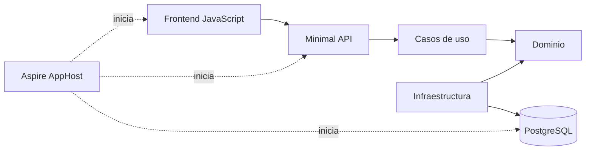

# Delivery Board

Aplicación para gestionar el trabajo de un equipo mediante un tablero sencillo con persistencia, pruebas y orquestación local.

## ¿Qué incluye?

- **Frontend:** HTML, CSS y JavaScript sin frameworks.
- **API:** Minimal APIs con .NET 10 y C# 14.
- **Aplicación:** casos de uso explícitos, sin MediatR.
- **Dominio:** entidad, reglas de negocio y contrato del repositorio.
- **Infraestructura:** Entity Framework Core, migraciones y PostgreSQL.
- **Pruebas:** pruebas unitarias de los casos de uso con xUnit.
- **MCP:** dos tools para explorar el esquema PostgreSQL y ejecutar consultas de lectura.
- **Asistente:** consultas en lenguaje natural desde el frontend, con Ollama u OpenAI y herramientas del MCP. La API reúne el streaming en una respuesta completa. [Configuración y ejemplos](docs/assistant.md).
- **Orquestación:** .NET Aspire levanta PostgreSQL, API, MCP, asistente y frontend.



## Requisitos

- .NET SDK 10.
- Node.js 20 o superior.
- Docker Desktop o un motor de contenedores compatible en ejecución.

## Ejecutar todo con Aspire

Desde la raíz de este proyecto, ejecuta:

```powershell
dotnet run --project backend/apphost/DeliveryBoard.AppHost/DeliveryBoard.AppHost.csproj
```

La terminal mostrará la dirección del panel de Aspire. Desde ese panel se puede observar el frontend en ejecución, abrir su URL y consultar sus logs.

El frontend utiliza siempre la misma dirección:

```text
http://localhost:3000
```

En el panel, `frontend-installer` termina después de ejecutar `npm install`. El recurso que representa el servidor web es `frontend`: debe aparecer como **Running** y mostrar `http://localhost:3000` en la columna de direcciones.

La documentación interactiva de la API está en la ruta `/swagger` del recurso `api`.

## MCP de PostgreSQL

El recurso `mcp` de Aspire expone Streamable HTTP en `/mcp`. Copia su dirección
del panel y añade `/mcp` para conectar un cliente compatible. Solo acepta acceso
local; no requiere autenticación y no habilita acceso CORS desde otras páginas.
El recurso `assistant` utiliza este MCP; los clientes externos se configuran por separado.

Aspire proporciona el secreto `mcp-reader-password`. Para fijar una contraseña
local, configura `Parameters:mcp-reader-password` en los secretos de usuario del
AppHost o la variable de entorno `Parameters__mcp-reader-password`; no la guardes
en archivos versionados. La API crea o actualiza `mcp_reader` después de las
migraciones, también sobre un volumen existente. El MCP recibe únicamente la
conexión de ese lector y su contraseña por separado; nunca recibe la conexión
administrativa de la API. Sin `McpReader:Password`, la API independiente conserva
su arranque habitual y no aprovisiona el lector.

### Tools

| Tool | Entrada | Resultado |
| --- | --- | --- |
| `get_database_schema` | `{}` | Esquemas de usuario y sus tablas, columnas, tipos, claves, relaciones, índices, vistas y secuencias, obtenidos de la base real. Incluye el historial de migraciones; excluye catálogos internos. |
| `execute_read_query` | `{ "sql": "SELECT ..." }` | Columnas con nombre y tipo, filas como arrays, número de filas devueltas e indicador y motivo de truncamiento. |

Ejemplo de argumentos para consultar el tablero, respetando las mayúsculas de
las columnas PostgreSQL:

```json
{
  "sql": "SELECT \"Id\", \"Title\", \"Status\", \"Priority\" FROM public.work_items ORDER BY \"CreatedAt\" DESC"
}
```

Las consultas admiten CTE, joins y agregaciones. Se acepta una sola sentencia
de lectura y se rechazan escrituras y control de sesión o transacción. Cada
ejecución utiliza una transacción `READ ONLY` que termina con rollback, además
de los permisos limitados del rol. Las respuestas de consultas tienen un máximo
de **1.000 filas**, **1 MiB de JSON del resultado** y **30 segundos** de ejecución
(el envoltorio del protocolo MCP añade bytes). El truncamiento
conserva filas completas y se indica expresamente; no hay paginación. Los
errores se devuelven como resultados MCP de error sin credenciales ni trazas
internas.

El proyecto `backend/src/DeliveryBoard.Mcp` contiene las capas internas `Tools`,
`Application` e `Infrastructure`, con Npgsql e inyección de dependencias propia.
No registra casos de uso de escritura ni ejecuta migraciones. Si el rol
`mcp_reader` ya existe y es ajeno a la aplicación o tiene privilegios peligrosos,
el aprovisionamiento falla en lugar de reutilizarlo silenciosamente.
La base debe tener funciones y extensiones de confianza: `READ ONLY` impide
escrituras PostgreSQL, pero no aísla efectos externos de funciones instaladas.

Para aislar un arranque de Aspire se puede elegir un volumen propio mediante
`Postgres__VolumeName`. El puerto local del MCP se puede cambiar mediante
`Mcp__Port` (predeterminado: `5091`).

La verificación con PostgreSQL aislado y un cliente MCP real está descrita en
[scripts/verification/mcp/README.md](scripts/verification/mcp/README.md).

## Compilar y ejecutar las pruebas

Desde la raíz del proyecto, ejecuta:

```powershell
dotnet test backend/DeliveryBoard.slnx
```

El comando restaura y compila la solución antes de ejecutar las pruebas.

## Validar el diff preparado

Desde la raíz del proyecto, prepara los cambios con `git add` y ejecuta:

```powershell
./scripts/validate-staged.ps1
```

La validación muestra el resumen del diff preparado, comprueba errores de espacios en
blanco, compila la solución y ejecuta sus pruebas. Para conectar la misma validación
a `pre-commit` y `pre-push` en este clon:

```powershell
./scripts/install-git-hooks.ps1
```

La instalación configura `core.hooksPath` localmente. `pre-commit` exige que exista
un diff preparado; `pre-push` también funciona con el índice vacío y vuelve a ejecutar
la compilación y las pruebas del árbol de trabajo.

## Crear una migración

Las herramientas de Entity Framework están versionadas en el repositorio. Para crear otra migración:

```powershell
cd backend
dotnet tool restore
dotnet tool run dotnet-ef migrations add NombreMigracion `
  --project src/DeliveryBoard.Infrastructure `
  --startup-project src/DeliveryBoard.Api `
  --output-dir Persistence/Migrations
```

La API aplica las migraciones pendientes al arrancar.

## Endpoints

| Método | Ruta | Uso |
|---|---|---|
| `GET` | `/health` | Comprueba que la API responde. |
| `GET` | `/api/work-items/dashboard` | Devuelve las tareas y los totales del tablero. |
| `POST` | `/api/work-items` | Crea una tarea nueva. |
| `PATCH` | `/api/work-items/{id}/start` | Inicia una tarea pendiente; devuelve `workItem` y `changed`. |
| `PATCH` | `/api/work-items/{id}/complete` | Marca una tarea como completada. |
| `PATCH` | `/api/work-items/{id}/owner` | Reasigna el responsable de una tarea pendiente o en curso. |
| `PATCH` | `/api/work-items/{id}/priority` | Guarda la prioridad de una tarea en cualquier estado. |
| `DELETE` | `/api/work-items/{id}` | Elimina permanentemente una tarea: `204` sin contenido si se elimina, `404` si ya no existe. |

### Iniciar una tarea

Pulsa **Iniciar** en una tarea pendiente, entre **Cambiar responsable** y **Completar**, sin confirmación adicional. Mientras aparece **Iniciando…**, esa tarea y **Actualizar** quedan bloqueados; puedes seguir creando tareas o trabajar en otras tarjetas. Tras confirmar el resultado, muestra **En curso** y actualiza Pendientes y En curso sin recargar la página. Los borradores de responsable se conservan.

`PATCH /api/work-items/{id}/start` no recibe cuerpo. Devuelve `200` con `{ "workItem": { ... }, "changed": true }` al iniciar; repetir sobre una tarea en curso devuelve `changed: false` y no escribe de nuevo. Una tarea completada produce `409`; si no existe al cargar, `404`. Las escrituras concurrentes también pueden producir `409`, sin reintentos automáticos: pulsa **Actualizar** para revisar la vista. Completar sigue permitido directamente desde pendiente o desde en curso.

Si falla la lectura posterior al inicio confirmado, se conservan el estado y las cifras confirmadas; pulsa **Actualizar**. Ante error de red o respuesta incompleta, el resultado queda sin confirmar: actualiza antes de volver a intentarlo.

### Cambiar responsable

1. Pulsa **Cambiar responsable** en una tarea pendiente o en curso.
2. Escribe el nuevo responsable, pulsa **Guardar** y confirma el título y el cambio **anterior → nuevo**.
3. El tablero conserva la misma tarea y su avance: solo cambia el responsable, no el identificador, título, prioridad, estado ni fecha de creación.

El nombre es libre y obligatorio: se eliminan espacios al principio y al final y se admiten hasta **80 caracteres** después de normalizarlo. Las tareas completadas no ofrecen esta acción y el servidor también rechaza su reasignación. Guardar el mismo nombre exacto normalizado es un no-op, sin escritura, pero exige las mismas precondiciones.

Escribir, perder el foco, **Cancelar** o rechazar la confirmación no envía cambios. Los borradores se conservan ante errores y actualizaciones mientras la tarea siga editable, pero se descartan al cancelar, guardar, desaparecer la tarea o pasar a completada. Son temporales en esta página: no sobreviven a cerrarla o recargarla.

Ejemplo de petición:

```http
PATCH /api/work-items/00000000-0000-0000-0000-000000000001/owner
Content-Type: application/json

{
  "owner": "Beatriz",
  "expectedOwner": "Ana"
}
```

`expectedOwner` es el responsable al abrir el editor, no un valor que se renueve silenciosamente al actualizar el tablero.

| Resultado | Qué hacer |
| --- | --- |
| `200` | Devuelve la tarea guardada, también para un no-op. Si falla el refresco posterior, el guardado sigue confirmado: pulsa **Actualizar**, no vuelvas a guardar por ese fallo. |
| `404` | La tarea ya no existe; el tablero la retira. |
| `422` | Revisa el responsable y la vista original; el borrador sigue disponible. |
| `409` | La tarea está completada, el responsable original quedó obsoleto o hubo un cambio concurrente al guardar. Pulsa **Actualizar**; si sigue editable, revisa el responsable actual y pulsa **Usar vista actual**. Esto solo prepara la vista: debes pulsar **Guardar** y confirmar nuevamente para enviar el cambio. |
| Error de red | El resultado no se puede confirmar. Se conserva el borrador; actualiza y revisa la vista antes de confirmar otra vez. No hay reintentos automáticos. |

Guardar, completar y eliminar comparten un bloqueo por tarea para evitar dobles acciones. **Actualizar** se bloquea durante peticiones; las lecturas anteriores a una mutación no pueden reemplazar una vista más reciente. Completar también puede responder `409` ante concurrencia y requiere actualizar antes de reintentarlo. Eliminar mantiene su contrato por identificador.

La protección del servidor compara valores de responsable y estado, también durante la escritura mediante tokens de concurrencia EF. **No detecta ciclos A → B → A ni mantiene historial**; no hay auditoría, catálogo de personas ni deshacer. Las pruebas unitarias con repositorios simulados no acreditan SQL ni carreras reales PostgreSQL. La comprobación manual del flujo y las pruebas HTTP/persistencia reales deben verificarse por separado.

### Eliminar una tarea

Pulsa **Eliminar** en una tarea del tablero, independientemente de su estado. La confirmación muestra el título y avisa de que la eliminación es permanente. Cancelar conserva la tarea; confirmar elimina únicamente esa tarea y actualiza la lista y los contadores.

Si la tarea ya no existe, se muestra «La tarea ya no existe.» y se actualiza el tablero. Los errores permiten reintentar; si la eliminación se confirma pero falla la actualización, se informa de ambos resultados y se puede pulsar **Actualizar**.

Ejemplo de petición, sustituyendo el identificador por el de una tarea de prueba:

```http
DELETE /api/work-items/00000000-0000-0000-0000-000000000001
```

La eliminación es individual. No hay eliminación masiva, papelera, recuperación ni deshacer.

Ejemplo de creación:

```json
{
  "title": "Revisar integración",
  "owner": "Ana",
  "priority": "High"
}
```

Las prioridades admitidas son `Low`, `Medium` y `High` (Baja, Media y Alta). Omitir `priority` o enviarla como `null` al crear asigna Media. La migración normaliza únicamente los NULL heredados y añade el default SQL Medium; conserva Low explícito.

### Cambiar prioridad

El selector **Prioridad** de cada tarjeta guarda al seleccionar Baja, Media o Alta, también en tareas completadas. Durante el guardado se bloquean las acciones de esa tarjeta y Actualizar. La confirmación aparece sin recargar; los borradores de responsable y las métricas se conservan.

`PATCH /api/work-items/{id}/priority` recibe `{ "priority": "High" }` y devuelve `200` con la tarea leída tras guardar. Solo escribe Priority por identificador: dos clientes pueden editar y prevalece el último guardado válido, incluso si coincide con una vista anterior. No compara una prioridad esperada; las protecciones de responsable y estado siguen vigentes.

Una prioridad fuera del catálogo produce `400`, tanto al crear como al editar; al editar, omitirla o enviarla como null también produce `400`. Un identificador válido inexistente produce `404`. Los errores ajenos mantienen sus contratos, incluido `422` para título/responsable inválidos.

Ante rechazo, fallo de red o respuesta incompleta, el selector recupera el último valor confirmado e informa de que hay que pulsar **Actualizar**. No afirma éxito ni reintenta la mutación automáticamente: la lectura posterior permite reconciliar un guardado cuyo resultado no se pudo confirmar. Tras un guardado confirmado, un fallo de refresco conserva su prioridad y se informa de ambos resultados.

Las comprobaciones PostgreSQL/HTTP de esta capacidad se encuentran en `scripts/verification/priority`; requieren exclusivamente el entorno aislado descrito en su README. La evidencia de navegador es histórica y debe repetirse tras nuevos cambios.

## Decisiones intencionadas

- No hay autenticación porque el foco está en el flujo de desarrollo.
- El filtrado y orden del frontend tienen pruebas Node sin dependencias; las reglas de negocio se prueban en Application.
- El frontend dispone de un proxy hacia la API y la API también habilita CORS para facilitar su uso directo durante la práctica.
- La política CORS es abierta porque este proyecto se ejecuta localmente con fines formativos; no es una configuración apropiada para producción.
- Los casos de uso dependen de una interfaz de repositorio y pueden probarse sin PostgreSQL.

## Contrato y verificaciones adicionales

Consulta docs/functional-contract.md para el alcance hasta sesión 9 y docs/session-9-completion.md para el avance observado. Los scripts PostgreSQL/HTTP de inicio están en scripts/verification/start; los de prioridad, en scripts/verification/priority. Son verificaciones locales explícitas, no requisitos para ejecutar la aplicación. Ningún framework o skill de IA está requerido.
### Filtrar y ordenar el tablero

Estado y prioridad se combinan: una tarea debe cumplir ambos filtros. **Bloqueadas** muestra únicamente pendientes con prerrequisitos incompletos. Los contadores siguen siendo globales. **Orden habitual** conserva el orden recibido del servidor; **Alta → Media → Baja** ordena la vista filtrada y conserva ese orden habitual entre prioridades iguales. Editar la prioridad vuelve a aplicar los filtros y el orden sin recargar.

Pruebas de estas reglas de vista (Node, sin instalar paquetes):

```powershell
node --test frontend/tests/board-view.test.js
```

Estas pruebas no sustituyen la comprobación del flujo completo en navegador.

Los filtros de estado y prioridad y el orden se restauran al recargar en el mismo navegador/origen. Solo se guardan esos controles, nunca los borradores. Si el almacenamiento está bloqueado o contiene valores inválidos, la página sigue funcionando con los valores predeterminados correspondientes.

## Monorepo: aplicación y agente LangGraph

Este repositorio reúne la aplicación existente y el agente independiente de
Delivery Board para preparar evaluaciones y CI/CD.

```text
backend/     API, dominio, persistencia, MCP y orquestación existentes
frontend/    Interfaz de Delivery Board
agent/       Agente TypeScript con LangChain/LangGraph, skills y guías
evals/       Preparación de futuras evaluaciones (todavía sin implementar)
docs/        Documentación de la aplicación y del monorepo
scripts/     Herramientas y verificaciones existentes
```

El nuevo agente está en [agent/README.md](agent/README.md) y tiene su propia
configuración. Desde la raíz, entra en `agent/`, instala sus dependencias con
`npm ci` y crea tu `.env` a partir de `.env.example` antes de utilizarlo.
Configura ahí tus claves y las direcciones reales de la API y del MCP.
No se distribuyen claves ni archivos `.env` de trabajo.

La copia a `agent/` no cambia el arranque de Aspire ni sustituye el asistente
.NET que utiliza actualmente la interfaz. El agente TypeScript se inicia por
separado; su integración en el workflow de CI se preparará posteriormente.

Consulta [la organización del monorepo](docs/monorepo.md). Los hooks Git
existentes se conservan; su instalación continúa siendo una decisión local.

## Licencia

Código del proyecto disponible bajo [licencia MIT](LICENSE). Las dependencias
y los componentes de terceros conservan sus propias licencias.
