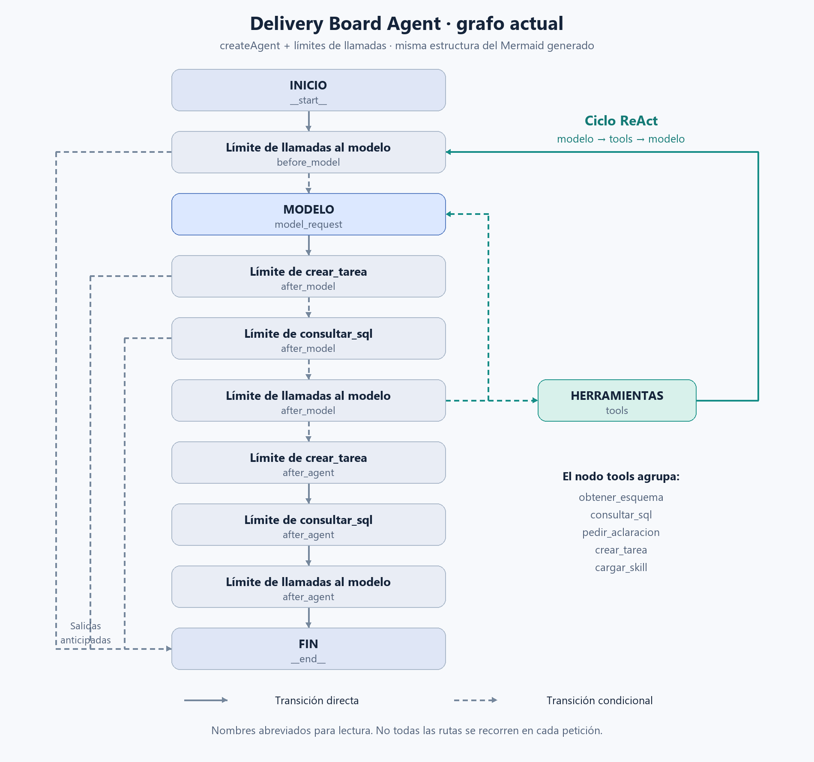

# Sesión 15 · Observar y proteger nuestro agente

## ¿Qué vamos a ver hoy?

En la sesión anterior construimos **Delivery Board Agent** con `createAgent`: un agente que usa un modelo, consulta herramientas y repite ese ciclo cuando lo necesita. Es la dinámica **ReAct**, no React para interfaces.

Hoy no vamos a empezar otro agente. Vamos a mejorar el que ya tenemos:

1. Conectar la aplicación local con **LangSmith**.
2. Ver qué ocurre durante una petición: modelo, herramientas, tiempos y errores.
3. Añadir un **guardrail sencillo** y comparar una petición aceptada con otra bloqueada.

> La idea de hoy: no basta con que el agente responda; queremos entender qué hizo y controlar qué puede hacer.

---

## 1. ¿Qué es LangSmith?

**LangSmith es una plataforma para observar, depurar y evaluar aplicaciones con modelos de lenguaje.** En esta sesión utilizaremos su parte de observabilidad: la web donde veremos las ejecuciones de nuestro agente.

No es el modelo que responde ni sustituye a LangGraph:

| Pieza | Para qué la usamos |
| --- | --- |
| OpenAI u Ollama | Ejecutar el modelo. |
| `createAgent` sobre LangGraph | Organizar el ciclo del agente y sus herramientas. |
| LangSmith | Inspeccionar lo que ha pasado durante ese ciclo. |

Nuestro programa puede seguir ejecutándose **en local**. Al habilitar las trazas, enviamos información de sus ejecuciones a LangSmith; no necesitamos desplegar allí la aplicación.

Más información: [observabilidad en LangSmith](https://docs.langchain.com/langsmith/observability).

## 2. ¿Qué aporta la observabilidad?

Imaginemos esta pregunta:

> «¿Cuántas tareas hay?»

En consola podemos ver la respuesta final. Con observabilidad podemos investigar además:

- ¿Llegó a llamar al modelo?
- ¿Solicitó el esquema y ejecutó una consulta SQL?
- ¿Cuánto tardó cada paso?
- ¿Repitió alguna llamada? ¿Dónde apareció el error?

Esto ayuda a **encontrar fallos, detectar lentitud y mejorar el comportamiento** del agente. Los tokens y costes se podrán analizar cuando estén disponibles; no debemos confundir una estimación con una factura, ni atribuir a Ollama un coste de API de OpenAI.

Dos palabras que veremos:

- **Telemetría:** los datos que recogemos, como tiempos, llamadas y errores.
- **Observabilidad:** utilizar esos datos para entender qué está pasando.

Una **traza** agrupa los pasos de una petición. Dentro veremos ejecuciones individuales, como una llamada al modelo o a una herramienta. Una conversación puede contener varias trazas.

> Vemos llamadas, mensajes y resultados registrados; no una lectura del razonamiento interno del modelo.

---

## 3. El grafo de nuestro Delivery Board Agent

La imagen representa el grafo de la versión actual. Los nombres largos de los middleware están abreviados para facilitar la lectura. El [Mermaid del grafo](imagenes/delivery-board-agent.mmd) conserva los nombres originales.

Para entenderlo, nos quedamos con tres ideas:

1. **Modelo:** recibe los mensajes y puede pedir herramientas o producir una respuesta.
2. **Herramientas:** ejecutan la acción solicitada y devuelven el resultado al ciclo del modelo.
3. **Middleware:** intervienen en puntos del recorrido; aquí aparecen nuestros límites de llamadas.

El nodo `tools` agrupa las herramientas disponibles: `obtener_esquema`, `consultar_sql`, `pedir_aclaracion`, `crear_tarea` y `cargar_skill`. **No se ejecutan todas en cada petición.** Las aclaraciones y confirmaciones pueden pausar el flujo para esperar al usuario.

El dibujo muestra las rutas posibles; una traza de LangSmith muestra el recorrido que realmente siguió una petición.

---

## 4. ¿Qué es un guardrail?

Un **guardrail es un control que ayuda a mantener al agente dentro de unas reglas**. Podemos colocarlo antes de llamar al modelo, antes de una herramienta o al revisar una respuesta.

Ejemplos: validar una entrada, limitar llamadas, pedir confirmación antes de escribir o evitar que se expongan datos sensibles.

**Un prompt orienta; una validación en código puede hacer cumplir una regla concreta.** Decir «no hagas demasiadas llamadas» no es lo mismo que programar un límite.

Un middleware es un mecanismo para intervenir en la ejecución. Puede implementar un guardrail, pero también otras funciones: **no todo middleware es un guardrail**. Existen controles basados en reglas y otros que usan modelos; hoy utilizaremos una regla sencilla en código.

Más información: [guardrails con LangChain y LangGraph](https://docs.langchain.com/oss/javascript/langchain/guardrails).

## 5. ¿Qué protección vamos a añadir hoy?

Nuestro proyecto ya tiene límites de llamadas, validaciones y confirmación antes de crear una tarea.

Como ejemplo nuevo, añadiremos este control:

> Si el último mensaje de texto del usuario supera 500 caracteres, responder de forma controlada sin llamar al modelo ni ejecutar herramientas.

Es un ejemplo didáctico para ver **entrada → comprobación → continuar o detenerse**. No detecta ataques ni sustituye a la autorización, la validación de SQL o los controles de la API. Los guardrails reducen riesgos, pero no garantizan por sí solos que un agente sea seguro.

Este nuevo control se implementará siguiendo la guía; todavía no forma parte del grafo de la imagen.

## 6. ¿Cómo se complementan?

| Observabilidad | Guardrails |
| --- | --- |
| Nos ayuda a ver y entender qué ocurrió. | Ayudan a controlar lo que puede ocurrir. |
| Ejemplo: detectar llamadas repetidas. | Ejemplo: establecer un límite de llamadas. |

**LangSmith observa; el control se ejecuta en nuestro agente.** Un guardrail no necesita LangSmith para funcionar, pero las trazas nos ayudan a comprobar su efecto. Un bloqueo controlado tampoco tiene por qué aparecer como un error: puede terminar con una respuesta normal.

> Antes de activar las trazas, revisaremos qué datos enviamos. No debemos registrar claves, secretos ni información sensible; usaremos datos de laboratorio y la configuración de privacidad de la guía.

---

## Seguimos con la práctica

1. [Configurar la observabilidad con LangSmith](OBSERVABILIDAD-LANGSMITH.md).
2. [Añadir el guardrail sencillo](GUARDRAIL-SENCILLO.md).

**Al terminar:** podremos explicar no solo qué respondió nuestro agente, sino qué pasos ejecutó y qué regla impidió una ejecución no permitida.
